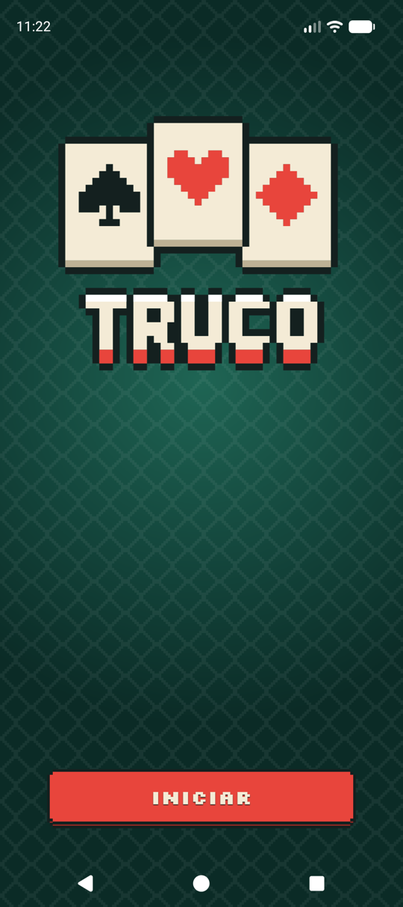
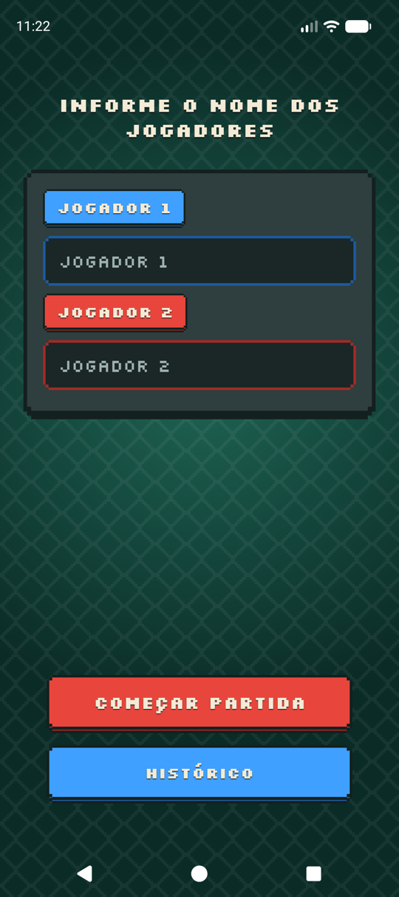
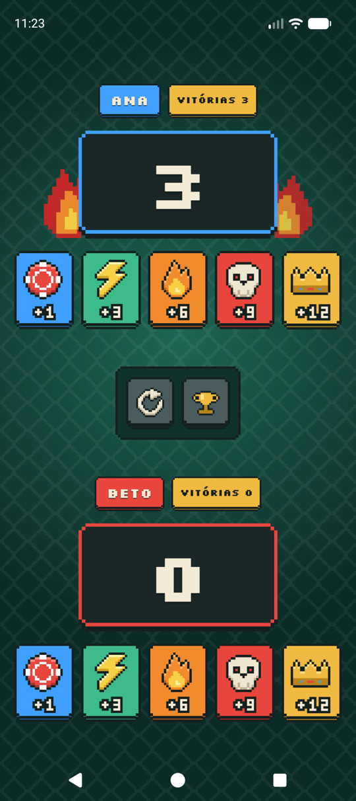
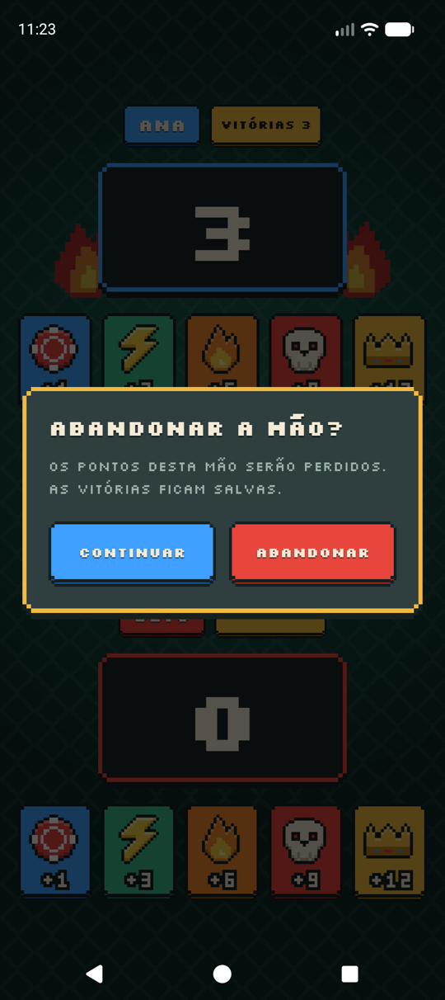
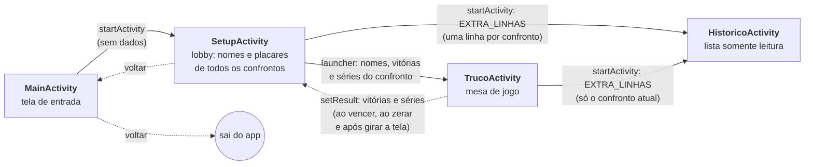

# Truco — marcador de pontos

Marcador de pontos para o jogo de baralho **Truco**, feito em **Kotlin + Views/XML** como avaliação da
Especialização em Programação para Dispositivos Móveis (UTFPR — Pato Branco). O enunciado pedia um placar
simples; aqui ele virou um pequeno jogo, com visual **pixel-art** inspirado no *Balatro*, animações,
histórico por confronto e um fogo que acende quando alguém emenda vitórias.

<p>
  
  
  
  
</p>

## Funcionalidades

- **Placar para dois jogadores** com cinco cartas de pontuação: **+1, +3, +6, +9 e +12**.
- **Vitória com 12 ou mais pontos**: aviso por Toast, os dois placares voltam a zero e a vitória é contada.
- **Nomes dos jogadores** escolhidos antes da partida: até 16 caracteres, com acentos e pontuação normais
  (vazio vira "Jogador 1/2"; nomes iguais são recusados). Só o `|` é barrado na digitação, porque separa os dois
  nomes na chave do confronto.
- **Histórico por confronto**: "Ana × Beto" e "Ana × Carlos" têm placares separados, e a ordem dos nomes não importa
  (Beto × Ana é o mesmo confronto).
- **Sequência de vitórias**: com 3 vitórias seguidas, um fogo acende atrás do placar; ele cresce aos 5 e aos 7 e
  apaga quando o adversário vence.
- **Zerar** o confronto atual, com aviso por Toast.
- **Confirmação ao abandonar a mão** (voltar com pontos em andamento).
- **Rotação de tela** preserva tudo; em paisagem os jogadores ficam lado a lado.

## Inspiração visual

O visual segue a linguagem do *Balatro* (feltro de mesa, painéis escuros com sombra sólida, números grandes,
fonte pixel, botões que "afundam"), mas **todo o material é original**: nenhum desenho, nome, fonte ou som do jogo
foi usado. É um projeto acadêmico, sem qualquer vínculo com o jogo.

| Elemento | Como foi feito |
|---|---|
| Fundo de feltro | Gradiente radial + losangos em "pixels" grandes (`bg_felt`, `felt_pattern.png`) |
| Caixas, botões, cartas, selos | Retângulos sobrepostos em `layer-list` formam **cantos em degrau** e uma sombra sólida ("lábio"); nítidos em qualquer densidade |
| Tipografia | **Silkscreen** (pixel, licença OFL), com acentos do português |
| Ícones das cartas | Pixel-art desenhada em grade de caracteres: chip (+1), raio (+3), chama (+6), caveira (+9), coroa (+12) |
| Placar | Caixa escura com moldura azul (Jogador 1) ou vermelha (Jogador 2) |
| Fogo da sequência | Sprite 12×16 em 3 níveis de cor (vermelho, amarelo, azul-branco), com tremeluzir |
| Animações | Botão afunda ao tocar, número conta até o novo valor, "+N" sobe e some, caixa treme na vitória |
| Toast, diálogo, ícone do app | Mesma caixa pixelada; o ícone adaptativo tem uma versão monocromática para ícones temáticos |

## Fluxo de telas



O botão **voltar** desfaz a navegação passo a passo: Histórico → tela anterior, Truco → Setup (com confirmação se
houver pontos na mão), Setup → Main e Main → fecha o app.

### O que passa de uma tela para outra

Todo o estado trafega por `Intent` (com `registerForActivityResult` na volta); não há banco, `ViewModel` nem
singleton. As chaves são constantes no `companion object` de cada Activity.

| De → Para | Mecanismo | Dados |
|---|---|---|
| Main → Setup | `startActivity` | nenhum |
| Setup → Truco | `launcherTruco.launch(intent)` | `EXTRA_NOME_J1/J2` (String), `EXTRA_VITORIAS_J1/J2` (Int), `EXTRA_SERIE_J1/J2` (Int) |
| Truco → Setup | `setResult(RESULT_OK, intent)` | `EXTRA_VITORIAS_J1/J2`, `EXTRA_SERIE_J1/J2` |
| Setup → Histórico | `startActivity` | `EXTRA_LINHAS` (`ArrayList<String>`, ex.: `"Ana 3 x 1 Beto"`, uma por confronto) |
| Truco → Histórico | `startActivity` | `EXTRA_LINHAS` com uma única linha (o confronto atual) |

O Histórico recebe **textos já prontos**, então não conhece chaves nem ordem de nomes e serve para os dois usos.

### Onde vive o estado

| Tela | Guarda | Sobrevive à rotação por |
|---|---|---|
| Setup | `chaves`, `vitoriasA/B`, `seriesA/B` (listas paralelas por confronto) e os nomes da partida atual | `onSaveInstanceState` |
| Truco | pontos da mão, vitórias e séries dos dois jogadores | `onSaveInstanceState` (os nomes vêm do `Intent`, que sobrevive) |
| Histórico | nada | releitura do `Intent` |

Cada confronto é identificado por `"NomeA|NomeB"` com os dois nomes em ordem alfabética (sem diferenciar
maiúsculas). O flag `invertido` diz se o Jogador 1 é o primeiro nome da chave, para as vitórias não trocarem de
dono quando a ordem de digitação muda.

## Regras do app

- **Pontuar**: cada carta soma ao jogador; com **≥ 12** ele vence. O estado (vitória somada, placares zerados) é
  resolvido primeiro e a animação só enfeita depois, então girar a tela no meio dela não perde nada.
- **Série de vitórias**: quem vence soma 1 à série e zera a do adversário. Fogo: nível 1 com 3+, nível 2 com 5+,
  nível 3 com 7+.
- **Zerar** (Truco): zera pontos, vitórias e série do confronto. Se o confronto volta a 0 × 0, ele **sai** da lista
  do Setup (a lista mostra só confrontos com vitórias).
- **Sair da mão**: com pontos em andamento, o voltar pede confirmação; as vitórias já conquistadas voltam ao Setup
  de qualquer forma, porque o resultado é preparado a cada vitória.

## Estrutura do projeto

```text
Truco/
├── app/src/main/
│   ├── java/br/edu/uftpr/truco/
│   │   ├── MainActivity.kt       tela de entrada
│   │   ├── SetupActivity.kt      lobby: nomes + placares por confronto (dono do estado)
│   │   ├── TrucoActivity.kt      mesa: pontuação, vitórias, séries e fogo
│   │   ├── HistoricoActivity.kt  lista somente leitura
│   │   ├── Efeitos.kt            animações (toque, contagem, "+N", tremor, fogo) e Toast
│   │   ├── Dialogos.kt           diálogo de confirmação pixelado
│   │   └── Barras.kt             barras do sistema transparentes com ícones claros
│   └── res/
│       ├── layout/               4 telas + dialog_pixel, toast_pixel, item_historico
│       ├── drawable/             caixas, cartas, ícones, logo e fogo (gerados)
│       ├── font/                 Silkscreen
│       └── values/, values-land/ cores, estilos e dimensões (retrato × paisagem)
├── tools/                        gerador dos assets pixel-art (Python, sem dependências)
├── licenses/                     licença da fonte
└── docs/screenshots/             imagens deste README
```

## Assets gerados por script

Os sprites não são imagens: são *vector drawables* gerados a partir de grades de caracteres.

```bash
python3 tools/gen_assets.py app/src/main/res /tmp/previews
```

Os desenhos ficam em `tools/pixel_sprites.py`; para mudar um sprite, edite a função `sprite_*()` e rode o script
(ele também grava PNGs ampliados em `/tmp/previews` para conferir). Os XMLs gerados trazem um comentário avisando
para não editá-los à mão. O script produz as cartas, os ícones de Zerar e Histórico, a logo, o fogo, o ícone do
app, todas as caixas pixeladas e o padrão do feltro.

## Como rodar

- **Requisitos**: Android Studio recente (AGP 9.5), dispositivo ou emulador com **Android 13+** (`minSdk` 33,
  `targetSdk` 37). O Gradle baixa o JDK configurado em `gradle/gradle-daemon-jvm.properties` sozinho.
- **Pelo terminal**: `./gradlew installDebug` com um aparelho conectado.
- **Dependências**: AppCompat, Material Components, ConstraintLayout e `activity-ktx`.

## Testes

| Tipo | Onde | O que cobre | Comando |
|---|---|---|---|
| Unitários (JVM) | `app/src/test/.../EfeitosTest.kt` | regra do fogo: limites 3 / 5 / 7 da sequência | `./gradlew testDebugUnitTest` |
| Instrumentação (Espresso) | `app/src/androidTest/.../` | `MainActivityTest`, `SetupActivityTest`, `TrucoActivityTest`, `HistoricoActivityTest` | `./gradlew connectedDebugAndroidTest` |

Os de instrumentação cobrem: pontuar com cada carta, vitória em ≥ 12 (e placares zerados), resultado devolvido ao
Setup (`setResult`), fogo acendendo/apagando, Zerar, rotação, diálogo ao abandonar a mão, validação dos nomes
(iguais, vazios, espaços, filtro do `|`, limite de 16) e o fluxo completo Setup → Truco → Setup → Histórico, com
confrontos separados e a ordem dos nomes trocada. Precisam de um emulador/aparelho conectado; as animações do
sistema são desligadas pelo Gradle (`animationsDisabled`) porque o Espresso não espera por elas. A lógica de
confrontos vive dentro do `SetupActivity` (privada), então é testada pela interface e não por testes unitários.

> **Atenção:** ao desligar as animações, o emulador pode ficar com elas em 0 depois dos testes. Para restaurar:
> `adb shell settings put global animator_duration_scale 1.0` (e o mesmo para `window_animation_scale` e
> `transition_animation_scale`).

## Relação com o enunciado

| Pedido | No app |
|---|---|
| Placar com +1, +3, +6, +9, +12 por jogador | Mesa do Truco, cartas com `ImageButton` |
| Vitória em ≥ 12 (Toast ou diálogo), zera e conta a partida | Toast, zera os dois placares, soma a vitória |
| Histórico com o nome e as vitórias | Histórico (Setup mostra todos os confrontos; Truco, só o atual) |
| Tela com dois campos e Confirmar para os nomes | Setup, com o botão "Começar partida" |
| Zerar com Toast | Botão de Zerar na mesa |

Diferenças em relação à estrutura do PDF: há uma **tela de entrada** (Main), os nomes são informados **antes** da
partida (o PDF abre direto no placar), e o histórico é **por confronto**, não um par de contadores fixos. Com os
contadores fixos, trocar um nome faria o novo jogador herdar as vitórias do anterior.

## Decisões e limitações

- **O histórico vive na memória do Setup.** Fechar o app, ou voltar do Setup para a Main, apaga os confrontos. O
  enunciado aceita variáveis em memória; persistir em disco (SharedPreferences) mexeria só no Setup.
- **O Toast usa layout próprio** (`setView`, deprecated), o que funciona na API 37 testada, mas pode se
  comportar diferente em outras versões.
- **Verificação**: testes automatizados (seção abaixo), conferência manual no emulador (retrato e paisagem) e lint
  sem erros. Os testes foram gerados com ajuda de IA e revisados.
- **Fora de escopo**: regras reais do truco (mão de onze, truco/retruco), desfazer pontos e apagar um confronto
  individual do histórico.

## Créditos e licenças

- Fonte **Silkscreen**, licença SIL Open Font License 1.1 (`licenses/Silkscreen-OFL.txt`).
- Inspiração visual: *Balatro*. Nenhum material do jogo é usado.
- Ícones, logo, sprites e animações: criados para este projeto.
